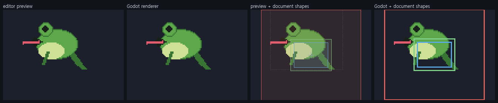

# MONSTER-STEP 3 안정화 — 참조 무결성, Staging 안전성, 렌더링 검증, STEP 4 준비

STEP 3([monster_editor_step3.md](monster_editor_step3.md))의 Animation / Collision 편집과 Staging을 안정화한 기록이다.
게임 런타임, `NetworkProtocol`(20), 세이브(v5), Schema(V1), Bridge protocol(1), Godot 버전(4.7.2)은 바꾸지 않았다.
추가된 Godot 파일은 staging 사본에서만 동작하는 검증 도구(`tools/monster_bridge/render_check.gd`, `.tscn`)뿐이다.

## 1. 기준과 통합

| 항목 | 값 |
|---|---|
| 브랜치 | `feature/monster-editor-step3-stabilization` |
| 출발점 | `feature/monster-editor-step3` = `94e0689` (STEP 2의 `95a0f7e`를 포함) |
| 통합한 master | `8a24f91` (merge base `6e35d51`, master 쪽 10개 커밋). 충돌 없이 병합 |
| 병합 직후 baseline | Monster Editor pytest 757 통과 / 5 건너뜀 (STEP 3 보고와 같은 수) |

master에서 온 Runtime 안정화(점프 패킷 재전송, CommandWatchdog, lifecycle idle 한도, map bridge 플랫폼 동기화,
functional / process 결과 분리)는 그대로 있다. 이 브랜치는 `tools/python_monster_editor/`, `tools/monster_bridge/`,
`.github/workflows/python-monster-editor.yml`, `docs/`만 고쳤다.

작업 중 같은 PC에서 다른 세션의 Godot 프로세스가 돌고 있었다. 건드리지 않았고, 이 브랜치의 검사는 자기가 시작한
프로세스만 종료한다.

## 2. 문제별 결과

| 항목 | 기존 문제 | 근본 원인 | 수정 | 결과 |
|---|---|---|---|---|
| FIX-01 | frame을 옮기면 그 frame의 Hurtbox 세트가 다른 frame에 붙는다 | GUI가 frame 배열만 `move_item` 했다. override와 `attack_hit_frame`은 **번호**로 frame을 가리킨다 | `application.animation.move_frame`: 이동 + 번호 재지정을 한 edit 목록으로. GUI는 성공을 확인한 뒤 선택을 옮긴다 | PASS |
| FIX-02 | frame 삭제는 override만 당기고 `attack_hit_frame`은 그대로였다. 마지막 frame도 지워졌다 | 번호 참조를 한 군데서 관리하지 않았다 | 이동·삭제·삽입·복제가 같은 mapping(`references.remap_frames`)을 쓴다. 타격 frame 삭제는 대체 frame을 **묻는다**. 마지막 frame 삭제는 거절 | PASS |
| FIX-03 | Clip 삭제가 역할·override만 정리하고 공격 패턴·AI의 참조를 끊었다 | 참조를 필드 경로로 하드코딩했다 | schema 순회로 참조를 찾는다(`references.incoming`). 게임플레이 참조가 있으면 거절하거나 대체 Clip으로 재연결. ID 변경 추가 | PASS |
| FIX-04 | 사용 중인 Hitbox 삭제 가능. 이미지 크기가 바뀌어도 갱신이 조용히 통과 | 위와 같음 | Hitbox는 이벤트 참조가 있으면 거절·대체. 이미지 갱신은 rect가 벗어나면 거절(rect를 줄이지 않는다). 이미지 삭제는 frame을 지우지 않는다 | PASS |
| FIX-05 | 좌표 변환이 화면 코드에 섞여 있었고 검증이 얕았다 | — | 변환 순서를 문서화하고 반전 상태의 양쪽 핸들 크기 조절, 왼쪽을 보는 아트, 확대·pan·visual_scale 분리, NaN·Infinity 입력을 테스트 | PASS |
| FIX-06 | 드래그 중 문서·Clip·frame이 바뀌면 다른 대상에 적용될 수 있었다 | 드래그가 "선택된 도형"만 기억했다 | 드래그는 세션(context, 도형, facing, 원래 값)이다. 하나라도 달라지면 취소. Esc·포커스 상실·workspace 전환·재생 시작도 취소 | PASS |
| FIX-07 | 일시정지 후 재생이 처음부터 다시 시작. 재생 중 판정 편집 가능 | 재생 상태가 "타이머가 도는가" 하나였다 | Qt 없는 `application.playback.Playback`: 정지 / 재생 / 일시정지. 재생 중 캔버스는 읽기 전용 | PASS |
| FIX-08 | frame cache가 개수(128)로만 제한 → 해상도에 따라 2 GiB까지 | — | 바이트 예산(96 MiB) + LRU. 큰 시트를 frame마다 통째로 다시 디코딩하던 것도 수정 | PASS |
| FIX-09 | `copytree(symlinks=False)`가 링크를 따라가 프로젝트 밖을 복사할 수 있었다 | — | 복사 전에 전체를 조사해 링크·junction·reparse point·특수 파일이 있으면 시작하지 않는다. 파일 수·크기·여유 공간 한도, 취소, 복사 중 원본 변경 감지 | PASS |
| FIX-10 | 표식 파일만 있으면 어떤 폴더든 지울 수 있었고 삭제 실패를 숨겼다 | 삭제 권한이 "표식 존재"였다 | `StagingSession`: 세션 ID가 표식과 일치하고 폴더가 만든 그대로일 때만 삭제. 실패는 `STAGING_CLEANUP_FAILED`로 보고하고 재시도 가능 | PASS |
| FIX-11 | 응답 검증·비교 중 예외가 나면 사본이 남았다 | 정리가 `BridgeError` 분기에만 있었다 | `stage_presentation`이 모든 경로에서 사본을 지운다(`keep=True`일 때만 호출자 소유) | PASS |
| FIX-12 | 응답 경로를 `res://`만 떼고 존재 여부만 봤다. Godot 쪽 입력 검증이 느슨했다 | — | 응답의 타입·세션·경로(사본 안, 허용 폴더, 확장자, 링크 경유 금지) 검사. stager가 모든 요청 값을 검사하고 다른 세션의 요청을 거절 | PASS |
| FIX-13 | 재읽기가 리소스를 만든 프로세스 안에서 이뤄졌다 | — | 두 번째 Godot 프로세스(`read_stage`)가 디스크에서 다시 읽는다. 생성 파일 해시를 엔진과 편집기가 각각 계산해 대조. 이미지 해시를 문서 기록과 대조 | PASS |
| FIX-14 | texture filter를 넘기기만 하고 비교하지 않았다 | — | profile과 실제 sprite 양쪽에서 비교. inherit(0)은 그 자체의 값으로 비교 | PASS |
| FIX-15 | 화면에 그려진 결과는 미검사였다 | staging이 headless였다 | `render_check.tscn` + `check_godot_render.py`: 실제 렌더러로 그려 미리보기와 비교 | PASS (§9) |
| FIX-16 | `gui/animation.py` 한 파일에 캔버스·cache·재생·workspace | — | `gui/preview_canvas.py`, `gui/frame_cache.py`, `application/playback.py`로 분리 | PASS |
| FIX-17 | 참조 편집 규칙이 편집 함수마다 따로 | — | `application/references.py` 하나 | PASS |
| FIX-18 | staging 결과가 언제까지 유효한지 표시가 없었다 | — | 결과에 문서·프로젝트 fingerprint. 편집·다른 문서·프로젝트 변경 시 "오래됨". 검사 영역을 나눠 표시 | PASS |
| FIX-19 | crash 재시도 기록이 횟수뿐이었다 | — | functional 결과와 process 결과를 분리(종료 코드, 첫 crash 로그). stage는 이전 시도의 출력을 지우고 다시 쓴다. 취소·제한 시간에 프로세스 트리를 끝낸다 | PASS |

엔진의 종료 crash(`0xC0000005`) 자체는 고치지 않았다([known_issues.md](known_issues.md)).

## 3. 참조 무결성 계약 (`application/references.py`)

Schema V1에는 두 종류의 참조가 있다.

**ID 참조.** `Id(ref=kind)`로 선언된 필드(또는 그런 key의 map)가 이미지·Clip·Hitbox·공격 패턴·상태를 이름으로
가리킨다. `references.incoming(document, kind, id)`가 schema 순회로 전부 찾는다 — 나중에 레지스트리에 모듈이나
이벤트가 추가돼도 이 코드는 바뀌지 않는다.

**frame 번호.** "Clip C의 N번째 frame"을 뜻하는 숫자. 정확히 둘이다.

| 필드 | 어느 Clip의 번호인가 |
|---|---|
| `collision.hurtbox_overrides[].frame` | 그 override의 `clip` |
| `presentation.attack_hit_frame` | `presentation.roles.attack`에 연결된 Clip (그 Clip에 그 번호의 frame이 실제로 있을 때만) |

공격 패턴의 이벤트는 **초 단위**다. frame 번호가 아니며 frame 순서를 바꿔도 건드리지 않는다.

| 편집 | 규칙 |
|---|---|
| frame 이동 | `move_mapping` (예: 4 frame에서 1→3이면 `{0:0, 1:3, 2:1, 3:2}`)으로 두 필드를 같이 옮긴다 |
| frame 삽입·복제 | 그 위치 이후 번호 +1. 복제본은 전용 Hurtbox 세트 없이 시작한다 |
| frame 삭제 | 뒤 번호 −1. 그 frame의 전용 세트는 확인 후 함께 삭제. **타격 frame이면** 어느 frame이 타격을 보여 줄지 사용자가 고른다(인접 frame으로 조용히 옮기지 않는다). Clip의 마지막 frame은 삭제하지 않는다 |
| Clip 삭제 | 역할 연결을 비우고 전용 세트를 지운다(확인 후). 공격 패턴·상태·이벤트가 참조하면 거절하거나 사용자가 고른 대체 Clip으로 재연결. 패턴이나 상태를 지우는 일은 없다 |
| Clip / Hitbox ID 변경 | core의 `rename_id`: 참조하는 필드가 전부 함께 바뀐다 |
| Hitbox 삭제 | 이벤트가 참조하면 거절하거나 대체 Hitbox로 재연결 |
| Hurtbox 삭제·ID 변경 | 참조하는 곳이 없다. override는 기본 세트의 "보기"가 아니라 세트 전체의 독립된 복사본이므로(`boxes`가 세트를 대체) 기본 Hurtbox를 고쳐도 override는 그대로다 |
| 이미지 삭제 | frame이 쓰고 있으면 거절하거나 크기가 맞는 다른 이미지로 재연결. frame을 지우지 않는다 |
| 이미지 갱신 | 새 크기에 rect가 들어가지 않는 frame이 있으면 거절. rect를 줄여 맞추지 않는다 |

모든 함수는 edit 목록을 돌려줄 뿐 적용하지 않는다. 한 동작의 edit을 `DocumentSession.apply`에 함께 넘기므로
원자적이고 Undo 한 단계다. 중간 상태의 문서는 존재하지 않는다.

frame의 동일성은 **위치**로 추적한다. 같은 이미지·같은 rect의 frame이 여러 개 있을 수 있으므로 그림으로 구별하지
않는다(테스트는 frame마다 다른 `duration`을 꼬리표로 쓴다).

**세션 규칙 두 가지** (`DocumentSession.apply`).

- 편집기가 없는 구역(`attack_patterns`, `behavior`)의 필드라도, 편집 가능한 대상(Clip·이미지·Hitbox)을 가리키는
  `Id(ref=…)` 필드는 재연결할 수 있다. 그 밖의 필드, 상태·패턴을 가리키는 참조, 그리고 가져온 문서가 `read_only`로
  묶은 구역은 여전히 거절된다.
- ID 변경(`rename_id`)은 경로가 없는 edit이라 이전에는 편집 가능 검사를 통과했다. 이제 그 대상이 정의된 구역이
  편집 가능해야 한다(가져온 몬스터의 Clip 이름은 바꿀 수 없다).

frame 고유 ID는 도입하지 않았다. V1의 번호 참조는 위 규칙으로 일관되게 유지된다. frame 단위 이벤트가 생기는
시점에는 번호 대신 ID가 필요해질 수 있다(§13).

## 4. Preview · 드래그 · 재생 계약

**좌표** (`gui/preview_canvas.py`, 식은 전부 `rtcmonster.geometry`).

```text
frame 픽셀 --sprite_to_actor(frame 크기, visual_offset, visual_scale, 기본 방향, facing)--> actor 좌표
actor 좌표 --(× zoom, + 위젯 중심, + pan)--> 화면 픽셀
```

- 도형은 actor 좌표, **오른쪽을 보는 상태로** 저장한다. 왼쪽 미리보기에서는 `mirror_shape`로 그리고 드래그한 점은
  `mirror_point`로 되돌린 뒤 쓴다. 저장되는 값은 미리보기 방향과 무관하다.
- zoom과 pan은 화면 상태일 뿐 도형에 닿지 않는다. `visual_scale`은 그림만 키우고 도형은 그대로다.
- Bottom-center 맞춤은 Clip의 **첫 frame** 크기 기준이다. V1에는 frame별 기준점이 없다. frame 크기가 섞인 Clip에
  적용하면 편집기가 그 사실을 알린다(검증의 `mixed_frame_sizes` 경고도 그대로 있다).
- 쓸 수 없는 값(NaN, Infinity, 0 이하의 크기, 빠진 필드)의 도형은 그리지도 집지도 않는다. 검증이 보고할 일이다.

**드래그.** 누를 때 `DragSession`(context = 문서 세션·Clip·frame, 도형, facing, 원래 값)이 만들어진다. 놓을 때까지
문서는 바뀌지 않고, 놓는 순간 편집 1회가 요청된다. 다음 중 하나라도 일어나면 드래그는 취소되고 아무것도 적용되지
않는다: Esc, 다른 문서·문서 닫기, 프로젝트 변경, Clip·frame 변경, 좌우 반전, 재생 시작, Undo/Redo로 그 도형이
바뀜, 도형 삭제, 목록에서 다른 도형 선택, 다른 마우스 버튼, 포커스 상실, 마우스 capture 상실, workspace 전환.
문서가 편집을 거절하면 도형은 원래 자리에 그려지고 선택은 유지된다.

**재생** (`application/playback.py`, Qt 없음).

| 상태 | 뜻 |
|---|---|
| 정지 | 시간 0 |
| 재생 | `advance(초)`가 시간을 진행 |
| 일시정지 | 시간 유지 |

재생 버튼은 일시정지 지점에서 이어서 재생한다. 끝난 one-shot Clip이나 정지 상태에서는 처음부터다. "처음으로"는
별도 버튼이다. one-shot Clip은 마지막 frame에서 스스로 일시정지한다. 초 = `duration / fps`
(`rtcmonster.timing`, 게임의 `EnemyAnimationProfile`과 같은 식). 한 번의 `advance`는 1초를 넘지 않는다.

재생 중에는 frame이 저절로 바뀌므로 판정을 편집할 수 없다(캔버스 읽기 전용, 숫자 입력 비활성). 일시정지하면 그
frame을 편집한다.

이것은 **미리보기 시계**다. 공격이 언제 맞는지는 physics tick(`timing.tick_of`)이 정하고 Clip과 무관하다.

## 5. Frame cache (`gui/frame_cache.py`)

| 제한 | 값 |
|---|---|
| 디코딩된 픽셀 합계(폭 × 높이 × 4) | 96 MiB |
| 항목 수 | 512 |
| 한 frame | 예산의 절반 이하. 넘으면 그리되 보관하지 않는다 |
| 마지막으로 디코딩한 시트 한 장 | 64 MiB 이하일 때만 (frame 예산과 별도) |

LRU다. key는 (프로젝트, 경로, 파일 내용 해시, rect)이므로 다른 프로젝트·바뀐 파일·다른 rect가 같은 frame을 돌려줄
수 없다. 실패한 디코딩은 기억하지 않는다. 프로젝트를 떠나면 그 프로젝트의 frame을, 이미지 갱신 시 그 파일의
frame을 버린다. 편집할 때마다 전체를 비우지 않는다.

파일 변경 감지는 크기와 수정 시각이다(빠르지만 둘 다 그대로인 채 내용만 바뀐 파일은 못 본다). "크기·해시 갱신"은
그 기억을 지우고 파일을 실제로 다시 읽는다.

**시트 재디코딩.** PNG는 중간부터 읽을 수 없어서 frame 하나를 잘라내려면 파일 전체를 디코딩한다. 측정해 보니
4096×4096 시트에서 frame당 157 ms였다. 마지막 시트 한 장을 보관하고 거기서 잘라내도록 바꿔 약 1 ms가 됐다(아래 표).

**실측** (`check_frame_cache.py`, Windows 11, 이 PC, 1회 실행. cache 추정치와 프로세스 working set은 다른 양이다):

| frame | 요청한 frame 수 (픽셀 합계) | cache 최대 | 보관된 frame | 밀려난 frame | 시트 디코딩 | working set: 시작 → 최대 → 비운 뒤 | 디코딩 / frame | cache hit / frame |
|---|---|---|---|---|---|---|---|---|
| 256px | 512 (128 MiB) | 96 MiB | 384 | 128 | 2회 | 46 → 207 → 46 MiB | 0.92 ms | 0.022 ms |
| 512px | 128 (128 MiB) | 96 MiB | 96 | 32 | 2회 | 46 → 207 → 46 MiB | 3.77 ms | 0.024 ms |
| 1024px | 32 (128 MiB) | 96 MiB | 24 | 8 | 2회 | 46 → 207 → 46 MiB | 14.64 ms | 0.033 ms |

32 frame Clip 400회 재생: frame당 0.0225 ms, 디코딩 32회, working set 증가 0 KiB.

cache 추정치는 예산을 넘지 않았다. working set은 그보다 크다 — 보관 중인 시트(64 MiB)와 Qt·할당자의 몫이다.
cache를 비우면 시작 수준으로 돌아왔다(누수 없음). 32 frame Clip을 400번 다시 재생해도 디코딩은 32번, working set
증가는 0 KiB였다.

## 6. Staging 계약 (`bridge/staging.py`)

```text
요청 검사 → StagingSession 생성(조사 → 복사 → 표식) → import → stage_monster
  → 응답 검사 → read_stage(새 프로세스) → 재읽기 검사 → 비교 → 결과 → 사본 삭제
```

**복사.** 복사 전에 대상 전체를 조사한다(`survey`). 심볼릭 링크, Windows junction, 그 밖의 reparse point, 일반 파일이
아닌 것이 하나라도 있으면 `STAGING_UNSAFE_SOURCE`로 시작하지 않는다 — 따라가면 프로젝트 밖을 복사할 수 있고, 조용히
빼면 게임에 필요한 리소스가 빠질 수 있기 때문이다. 복사하지 않는 최상위 폴더(`.git`, `.github`, `.claude`,
`.vscode`, `.idea`, `build`, `docs`, `devtools`, `artifacts`)와 `__pycache__`·`*.pyc`·`*.tmp`는 들여다보지 않는다.
`.godot`(import cache)은 복사한다. 파일 20만 개, 8 GiB, 여유 공간(필요량 + 256 MiB) 한도가 있고 넘으면
`STAGING_TOO_LARGE`다. 파일마다 취소를 확인하며 취소하면 부분 사본을 지운다.

복사는 파일 시스템 snapshot이 아니다. 복사 직후 원본의 크기·수정 시각이 조사 때와 다르면 `changed_during_copy`에
기록하고 결과의 `staging` 영역을 `WARNING`으로 표시한다.

**소유권.** 사본은 `StagingSession` 하나가 만들고 쓰고 지운다. 표식(`.rtc_monster_staging`)은 JSON이며 세션 ID,
원본 경로, 생성 시각, PID를 담는다. 삭제(`session.remove()`) 전에 확인하는 것:

- 폴더 이름이 `rtc-monster-stage-*`이고 그 안의 `project`가 세션이 만든 경로다.
- 폴더와 `project`가 링크·junction이 아니고, 만든 경로 그대로 resolve된다.
- 실제 프로젝트를 포함하지도, 그 안에 있지도 않다.
- 표식을 읽을 수 있고 세션 ID가 같다.

하나라도 아니면 `STAGING_NOT_OWNED`이고 아무것도 지우지 않는다. `remove_staging_copy(path)`는 이 프로세스가 만든
사본에만 동작한다 — 표식을 복사해 넣은 폴더는 지워지지 않는다.

**삭제 실패.** Windows의 파일 잠금에 대비해 0.25초 간격으로 4번까지 시도한다. 그래도 남으면
`STAGING_CLEANUP_FAILED`(경로, 첫 실패 항목, 원인, "실제 프로젝트에는 영향 없음")이고 세션은 `leftovers()`에 남아
다시 `remove()`할 수 있다. 검증 자체는 성공했는데 삭제만 실패하면 결과를 돌려주고 `StageResult.cleanup_error`에
적는다. 편집기는 그 경로를 사용자에게 보여 준다.

**수명.** `stage_presentation`은 돌아가기 전에 사본을 지운다 — 성공, `BridgeError`, 잘못된 응답, 예상 못 한
예외(`KeyError`·`TypeError`·`ValueError`·`OSError`), 취소 전부. `keep=True`면 호출자가 `result.session`을 소유하고
직접 지운다. `keep_on_failure=True`는 실패한 사본을 조사용으로 남기고 경로를 오류에 적는다. 취소는 남기지 않는다.

**이전 실행이 남긴 폴더.** 프로그램이 죽어 남은 사본은 `find_stale_copies()`가 표식 내용과 함께 나열할 뿐이다.
자동으로 지우지 않는다 — 실행 중인 다른 편집기의 것일 수 있다. 표식의 세션·시각·PID를 보고 손으로 지운다.

**응답 검사.** `sprite_frames_path`·`profile_path`는 `res://monster_stage/<monster_id>/` 아래의 `.tres`여야 하고,
OS 경로, `..`, 다른 확장자, 다른 폴더, 링크를 거쳐 사본 밖으로 나가는 경로는 `RESOURCE_PATH_INVALID`다. profile
재읽기의 모든 필드 타입을 확인한 뒤에야 비교에 넘긴다. 응답의 몬스터 ID와 staging 세션이 요청과 달라도 거절한다.

**비교.** 기존 항목(Clip·fps·loop·frame 수·텍스처 경로·region·duration·역할·scale·offset·facing·hit frame·속도)에
더해:

- texture filter: profile과 carrier의 실제 sprite에서 각각.
- 디스크 재읽기: 두 번째 프로세스의 재읽기가 만든 프로세스의 보고와 같은가.
- 생성 파일 해시: 엔진(`FileAccess.get_sha256`)과 편집기(`hashlib`)가 같은 값을 내는가.
- 이미지: 사본의 PNG가 문서가 기록한 해시의 그 파일인가. rect가 여전히 맞더라도 내용이 다르면 차이다("편집기에서
  이미지를 갱신하라"). 해시가 기록되지 않은 이미지는 비교할 수 없다고 적는다.

**결과** (`StageResult`).

| 필드 | 내용 |
|---|---|
| `differences`, `passed` | 구조 비교. `passed`는 렌더링·전투·네트워크·게시에 대해 아무것도 말하지 않는다 |
| `areas` | `staging` `resources` `readback` `images` `attach` — 검사함. `rendering` `combat_runtime` `network` `publish` — 항상 `NOT_EVALUATED` |
| `document_fingerprint`, `project_fingerprint` | 결과가 어떤 문서와 어떤 이미지·엔진 버전에 대한 것인가. `is_current(document)` |
| `resources` | 생성된 두 파일의 SHA-256 |
| `process` | 호출별 시도 횟수와 crash한 시도의 종료 코드 |
| `notes`, `cleanup_error`, `godot_version`, `session` | |

편집기는 결과를 문서 fingerprint와 프로젝트 generation에 묶어 둔다. 편집, 다른 문서, 프로젝트 변경 뒤에는
"Staging: 오래됨"으로 표시하고, 통과한 결과도 "구조 일치 (실제 렌더링·전투는 미검사)"라고 적는다.

## 7. Godot 쪽 검증 (`monster_stager.gd`)

- 표식이 있고 **요청의 `staging_session`이 표식의 세션과 같을 때만** 동작한다(`NOT_A_STAGING_PROJECT`,
  `STAGING_NOT_OWNED`). `read_stage`와 render check도 같은 검사를 쓴다.
- 모든 요청 값을 검사한다: ID 형식, 이미지 경로(`..`, `:`, `\`, `//`, 절대 경로, PNG 아님), 이미지·Clip·frame 수,
  fps (0, 120], duration (0, 100], loop가 bool, rect가 **정수 픽셀**이고 이미지 안, 역할이 staged Clip을 가리킴,
  scale > 0, hit frame이 [0, 64]의 정수, 속도가 0 이상, texture filter가 enum 범위. 틀리면 `INVALID_REQUEST`이고
  script error가 나지 않는다. 실제 엔진으로 13가지 잘못된 요청을 보내 확인한다(`check_godot_stage.py`).
- profile에 관한 검사를 **첫 파일을 쓰기 전에** 끝낸다.
- 출력 폴더의 이전 파일을 지우고 다시 쓴다. crash한 시도가 남긴 반쪽 파일이 다음 시도의 결과로 읽히지 않는다.

## 8. 프로세스 결과와 crash 정책

- `BridgeResponse.attempts`, `.crashes`(버린 시도의 종료 코드), `.crash_log`(첫 crash의 엔진 로그),
  `.process_result`(`CLEAN` / `CRASHED_THEN_RETRIED`). crash는 성공에 섞이지 않는다.
- 종료 코드만으로 "알려진 엔진 crash"라고 단정하지 않는다. 로그를 남겨 확인할 수 있게 한다.
- 재시도는 읽기 명령과, 버려도 되는 사본 안의 자기 출력만 다시 쓰는 `stage_monster`에만 한다(최대 3회). 실제
  프로젝트에 쓰는 작업은 재시도하지 않는다(그런 작업은 아직 없다).
- 취소·제한 시간에는 시작한 프로세스의 **트리**를 끝낸다(Windows `taskkill /T`, POSIX 프로세스 그룹). 자식이 남아
  작업 폴더를 잡고 있으면 사본을 지울 수 없기 때문이다. 대상은 편집기가 시작한 PID에서 찾으며 이름으로 찾지 않는다.

## 9. 실제 렌더링 검증 (`check_godot_render.py`)

staging 사본에서 `render_check.tscn`을 **창과 렌더러가 있는 상태로** 실행한다. 등록된 Enemy actor(carrier)에 staged
profile을 붙여, 실제 `EnemyAnimationPresenter`가 만든 sprite를 320×240 viewport(단위당 3 픽셀)에 그리고 PNG로
저장한다. 같은 frame을 편집기의 `PreviewCanvas`로 같은 크기·배율에 그려 비교한다.

| 비교 | 방법 |
|---|---|
| 위치·크기·반전 | scene tree가 말하는 frame 네 모서리 vs `geometry.sprite_to_actor` (허용 오차 0.01 px) |
| 픽셀 | 두 이미지의 bounding box, 한쪽에만 그려진 픽셀 수, 양쪽 모두 불투명한 픽셀의 색 차이 |
| frame region | sprite가 실제로 쓴 텍스처·region vs 문서의 이미지·rect |
| texture filter | profile과 sprite |
| 역할 | 상태를 강제했을 때 실제 presenter가 고른 Clip (idle, move, attack, hurt, death, jump, fall) |
| frame duration·loop | `AnimatedSprite2D`를 실제로 재생하며 매 frame 기록한 (경과 시간, frame) vs `timing.frame_at` |

이 PC에서 두 렌더러로 실행했다: **forward_plus / d3d12** 와 **gl_compatibility / opengl3** (NVIDIA GeForce RTX 3070 Laptop GPU). 결과는 두 렌더러에서 같았다.

| 몬스터 | carrier | scale · offset | filter | 스크린샷 | 미리보기와 픽셀 동일 | 위치 오차 | 한쪽에만 그려진 면적 | 위치·역할·필터·재생 시간 |
|---|---|---|---|---|---|---|---|---|
| Sewer Beetle | `sewer_beetle` | [1, 1] · [0, -13] | 1 | 20 | 20 | 0 px | 0.0% | 일치 |
| Frog | `frog` | [1, 1] · [4, -19] | 1 | 32 | 32 | 0 px | 0.0% | 일치 |
| 새 초안 | `sewer_beetle` | [1.5, 1.5] · [0, -16.67] | 1 | 20 | 6 | 1 px | 2.8% | 일치 |

개구리에서 실제 presenter가 고른 Clip: attack → `attack`, death → `death`, fall → `fall`, hurt → `hurt`, idle → `idle`, jump → `jump`, move → `idle`. 재생 시간은 Clip마다 한 번 실제로 재생해 매 frame 기록했다(딱정벌레 idle 84표본).

nearest 필터와 정수 배율에서는 미리보기와 **픽셀까지 같다**. 새 초안은 일부러 `visual_scale` 1.5(× 3 = 4.5, 정수가
아님)로 만들었다: 가장자리 픽셀이 렌더러마다 다르게 반올림되므로 위치(±1 px)와 덮인 면적(6% 이내)만 판정하고 색
차이는 기록만 한다.

증거: [monster_editor_step3_screens/](monster_editor_step3_screens/) — 각 장은 왼쪽부터 편집기 미리보기, Godot
렌더러, 미리보기 + 문서의 도형, Godot + 문서의 도형이다.



**한계.**

- 도형 overlay는 이 검사가 **문서에서** 그린 것이다. 게임은 문서의 Hitbox와 frame별 Hurtbox 세트를 쓰지 않는다
  (STEP 4). overlay가 보인다고 판정이 구현된 것이 아니다.
- `jump_start`·`land`는 presenter 내부 타이머로만 나타나므로 강제하지 않았다(개구리에서 "강제하지 않음"으로 기록).
- 렌더러가 없는 환경은 `NOT_EVALUATED`다. headless 검사로 대체하지 않는다.
- carrier는 몬스터마다 자기 actor를 썼다(딱정벌레·개구리). 새 초안은 딱정벌레 actor가 carrier다 — 데이터 기반
  actor는 아직 없다.

## 10. GUI 책임 분리

| 파일 | 책임 | Qt |
|---|---|---|
| `application/references.py` | 참조 조회, 영향, 재연결, ID 변경, frame 번호 재지정 | 없음 |
| `application/animation.py` | 동작 하나 → edit 목록 | 없음 |
| `application/playback.py` | 재생 상태와 시간 조회 | 없음 |
| `gui/frame_cache.py` | 디코딩과 메모리 | 있음 |
| `gui/preview_canvas.py` | 그리기, 좌표, 도형 선택·드래그. 문서·세션·파일을 모른다 | 있음 |
| `gui/animation.py` | workspace: 목록, 버튼, 확인 대화, 선택 | 있음 |
| `gui/render_compare.py` | 미리보기 이미지와 스크린샷 비교 | 있음 |
| `bridge/staging.py`, `bridge/rendering.py` | staging 세션, 렌더 검사 실행과 기대값 | 없음 |

Animation과 Collision은 한 캔버스에서 같은 선택(Clip, frame, 도형)을 쓰므로 workspace를 둘로 나누지 않았다.

## 11. 성능

같은 PC, 네이티브 Windows, 1회 실행(`main.py --smoke-report`).

| 동작 | 100% | 150% | 200% |
|---|---|---|---|
| workspace로 전환 | 36.42 ms | 39.56 ms | 43.08 ms |
| frame 선택 | 8.5 ms | 8.42 ms | 8.66 ms |
| frame 이동 (세트·타격 frame 포함, 편집 1회) | 21.0 ms | 37.19 ms | 38.8 ms |
| 그 이동의 Undo | 10.41 ms | 12.68 ms | 12.99 ms |
| 드래그 중 마우스 이동 20회 (문서 변경 없음) | 7.64 ms | 7.99 ms | 8.12 ms |
| 드래그 확정 (편집 1회) | 13.52 ms | 14.64 ms | 15.32 ms |

| 문서 규모 | 표시 | 편집 1회 | Undo | 검증 + 목록 |
|---|---|---|---|---|
| Small | 47.64 ms | 23.71 ms | 14.84 ms | 15.92 ms |
| Medium | 81.37 ms | 47.03 ms | 15.49 ms | 32.3 ms |
| Large | 142.34 ms | 95.76 ms | 20.0 ms | 69.54 ms |

Large 문서의 편집 1회는 STEP 2에서 91~97 ms, STEP 3에서 89.9 ms였고 이번 측정은 95.76 ms다(같은 PC, 다른 날, 다른 세션의 Godot이 함께 돌고 있었다). 참조 재지정이 붙은 frame 이동도 작은 문서에서 편집 1회와 같은 수준이다.

드래그 중에는 문서를 건드리지 않는다(이동 20회에 약 8 ms). 편집 비용의 대부분은 여전히 core의 정규화와
fingerprint이고(STEP 3에서 분석한 그대로) 이번에 바꾸지 않았다.

## 12. 검증 기록

Windows 11, Python 3.14.5, PySide6-Essentials 6.11.3, Godot 4.7.2-stable. 코드 커밋 `9e83ad0`에서 실행했다(그 뒤의
커밋은 문서와 증거 파일뿐이다). Godot을 쓰는 검사는 순차로 돌렸다.

| 검사 | 실제 Godot | 실제 GUI | 실제 렌더러 | 결과 |
|---|---|---|---|---|
| `pytest tools/python_monster_editor/tests` (네이티브) | — | Qt 위젯 + `QTest` 입력 | — | 911 통과, 8 건너뜀 |
| 같은 명령, `QT_QPA_PLATFORM=offscreen` | — | offscreen | — | 909 통과, 10 건너뜀 |
| `pytest tools/python_map_editor/tests` | — | — | — | 184 통과, 3 건너뜀 |
| `tools/check_project.py` | 예 | — | — | `ALL PROJECT CHECKS PASS` |
| `check_godot_contract.py` | 예 | — | — | 205 통과, 3 미검사 (environment·registry·legacy PASS) |
| `check_contract_extensibility.py` | 예 | — | — | PASS |
| `check_godot_import.py` | 예 | — | — | 45 통과 |
| `check_godot_stage.py` | 예 | — | — | PASS, 실패 0 (2회 연속). 프로젝트 파일 1094개의 해시가 전후 같음 |
| `check_godot_render.py` (forward_plus / d3d12) | 예 | 미리보기 캔버스 | **예** | PASS (2회 연속) |
| `check_godot_render.py --rendering-method gl_compatibility` | 예 | 미리보기 캔버스 | **예** (opengl3) | PASS |
| `check_frame_cache.py` | — | Qt 디코딩 | — | PASS |
| GUI 스모크 100% / 150% / 200% (`main.py --smoke-report`, 실제 Godot) | 예 | **네이티브 창, 실제 입력** | — | 각 49 통과 |
| `test_multiplayer_restart.py` 2인 valid·invalid, 3인 valid | 예 | — | — | 통과 |
| `test_multiplayer_worlds.py` / `world_runtime.py` / `forest.py` 2·3인 | 예 | — | — | 통과 |
| Map Editor `check_scene_bridge.py`, `check_enemy_spawn_bridge.py` | 예 | — | — | 통과 (V6 round trip 2/2, data safety PASS) |

건너뛴 8건: 심볼릭 링크를 만들 권한이 없는 Windows 계정에서의 링크 테스트(Linux CI에서 실행된다). Windows junction은
권한이 필요 없어 실제로 만들어 검사했다. offscreen에서는 창 단위 단축키 2건이 더 빠진다.

**회귀 중 드러난 것.**

- 첫 전체 실행에서 Godot의 종료 crash(`0xC0000005`)가 세 군데서 났다: staging 사본의 `--import`, 거절을 기대한 Bridge
  호출 하나(3회 연속), 렌더 검사 한 번. 앞의 둘은 재시도가 없는 경로였고 세 번째는 재시도 3회를 다 썼다. 같은 PC에서
  다른 세션의 Godot이 계속 돌고 있었다. import와 렌더 실행을 crash 재시도 대상에 넣고(둘 다 버려도 되는 사본에서
  처음부터 다시 하는 작업이다), 검사 스크립트는 "거절되는가"라는 질문을 crash로 답을 못 얻었을 때 다시 묻도록 했다.
  그 뒤 staging 2회·렌더 3회가 모두 통과했고 기록된 crash는 0건이었다. crash 원인 자체는 여전히 엔진 쪽이다.
- 렌더 씬이 viewport를 트리에 넣기 전에 `canvas_transform`을 지정해 엔진이 `ERROR:` 한 줄을 냈다(결과는 맞았다).
  순서를 고쳤고, 렌더 검사는 이제 자기 씬의 로그에 `ERROR:`가 있으면 실패한다.
- 취소된 staging의 사본이 지워지지 않는 경우를 테스트가 찾았다: 종료시킨 프로세스의 자식이 작업 폴더를 잡고 있었다.
  프로세스 트리를 끝내도록 고쳤다.
- frame cache 실측이 시트 재디코딩(frame당 157 ms)을 찾았다(§5).
- 참조 재연결이 세션에서 거절됐다: 편집기가 없는 `attack_patterns` 구역의 필드였기 때문이다. 참조 필드만 통과시키는
  세션 규칙을 넣었다(§3). 같은 검토에서 `rename_id`가 편집 가능 검사를 건너뛰던 것도 막았다.

**CI.** `feature/monster-editor-step3-stabilization`의 GitHub Actions 결과는 푸시 뒤 최종 SHA로 확인한다. 렌더링 step은
runner가 렌더할 수 없으면 NOT_EVALUATED를 job summary에 남긴다 — 위 표의 렌더링 결과는 개발 PC의 것이다.


**확인하지 않은 것.** 사람이 직접 조작한 검사(입력은 `QTest` 이벤트). OS 파일 대화상자. macOS. Linux에서의 창 단위
단축키. 실제 전투·네트워크·게시(해당 기능 없음). Windows 릴리스 빌드와 lifecycle probe는 이 브랜치에서 다시 돌리지
않았다 — 게임 코드를 바꾸지 않았고, 그 결과는 [runtime_stabilization.md](runtime_stabilization.md)의 것이다.

## 13. STEP 4 확장 가이드

공격 패턴 편집기가 그대로 쓰는 것:

| 필요 | 쓰는 것 |
|---|---|
| 같은 문서·같은 Undo | `MainWindow.apply_edits` → `DocumentSession.apply`. workspace는 `edits_requested(edits, label)`만 낸다 |
| "지워도 되나, 무엇이 깨지나" | `references.incoming` / `blocking` / `describe`, `animation.hitbox_usages`, `animation.clip_usages` |
| 재연결·ID 변경 | `references.retarget`, `references.rename`, `animation.remove_box(document, slot, replace_with=…)` |
| Hitbox 목록과 강조 | `animation.shape_slots(data, clip, frame)`, `AnimationWorkspace.highlight_box("hitbox", id)` |
| 미리보기 | `PreviewCanvas` (문서를 모른다: pixmap·frame 크기·presentation·도형을 넘긴다), `frame_cache.load_frame` |
| 타임라인 시간 → 미리보기 | `AnimationWorkspace.seek(초)` / `select_frame(n)`, `playback.time` / `frame` / `frame_window` / `duration` / `loop_count` |
| 선택 따라가기 | `AnimationWorkspace.selection_changed(clip, frame, slot)` |
| 현재 frame의 Hurtbox 세트 | `animation.effective_hurtboxes(data, clip, frame)` (frame 전용 → Clip 전용 → 기본) |
| staging·검증 | `StagingSession`, `stage_presentation(keep=True)`, `rendering.render_staged` |

두 시간축은 계속 따로다.

```text
Animation 시간     = 표현. playback.time, 초 = duration / fps
Attack Timeline 시간 = 서버 권위. timing.tick_of(초, tick_rate)
```

타임라인 화면은 둘을 나란히 보여 줄 수 있지만 Clip의 frame이 이벤트 시각을 정하지 않는다.

**Schema V2 후보** (이번에 도입하지 않았다. 호환성이 실제로 깨지는 시점에 migration과 함께):

| 후보 | 이유 |
|---|---|
| `presentation.texture_filter` | 지금은 가져온 문서의 passthrough에만 있다. 새 초안·복제본은 profile 기본값(nearest)이 된다 |
| frame 고유 ID | frame 단위 이벤트가 생기면 번호 재지정 대상이 늘어난다 |
| frame별 anchor | 크기가 다른 frame의 발 위치 |
| `hitboxes[].target_test`, `Hop.near_goal_*` | 개구리의 미지원 2건 (기존 결정) |

## 14. 하지 않은 것

공격 패턴 편집기, 타임라인 실행기, `DataEnemyDefinition` / `DataEnemyAgent`, 실제 피해 판정, frame별 Hurtbox의
런타임 적용, 프로토콜 변경, AI 그래프, 게시, EXE, Godot 엔진 수정·버전 변경, 게임 네트워크 코드 수정.
