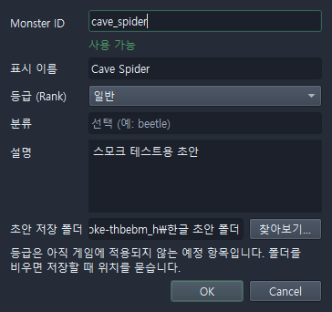
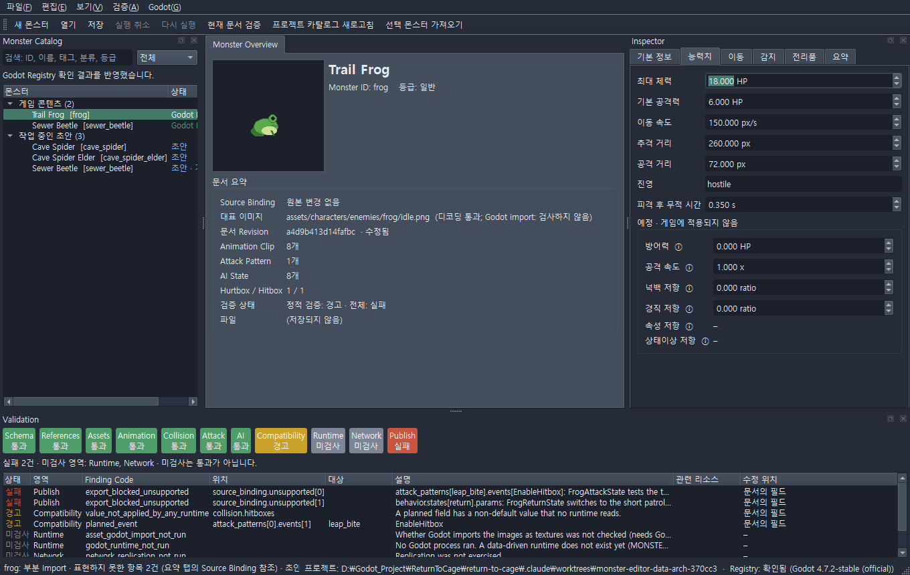

# Monster Editor 사용 가이드 (MONSTER-STEP 2)

몬스터의 기본 정보·능력치·이동·감지·전리품을 `.rtcmonster` 초안으로 만들고, 게임에 이미 있는 몬스터의 값을
가져와 볼 수 있다. **이 단계의 편집기는 게임을 바꾸지 않는다.** 초안을 게임에 넣는 기능(게시)은 아직 없다.

## 실행

```sh
python -m pip install -r tools/python_monster_editor/requirements.txt     # Python 3.14, PySide6
python tools/python_monster_editor/main.py [문서.rtcmonster]
```

## 처음 설정

`파일 → 프로젝트 설정…`

| 항목 | 설명 |
|---|---|
| 프로젝트 폴더 | `project.godot`이 있는 ReturnToCage 폴더. 비워 두면 프로젝트 없이 초안만 편집한다 |
| Godot 실행 파일 | Godot 4.7.2. 게임 몬스터 목록 확인과 가져오기에만 필요하다 |
| 초안 폴더 | `.rtcmonster` 초안을 두는 폴더. 한글·공백 경로 가능 |

설정은 다음 실행 때 복원된다. 저장해 둔 경로가 더 이상 없으면 그 사실을 알리고 프로젝트 없이 시작한다.

프로젝트 없이 쓸 때의 차이: 게임 몬스터가 목록에 나오지 않고, ID 중복·이미지·아이템 참조를 확인할 수 없다.
이 항목들은 검증에서 "미검사"로 나온다. **미검사는 통과가 아니다.**

## 화면


- **Monster Catalog**(왼쪽): 게임 콘텐츠 / 작업 중인 초안 / 문제가 발견된 콘텐츠. 검색(ID·이름·태그·분류·등급)과
  필터. 더블클릭 또는 Enter로 초안을 연다.
- **Monster Overview**(가운데): 대표 이미지, 문서 요약, 원본 상태, 검증 상태.
- **Inspector**(오른쪽): 기본 정보 · 능력치 · 이동 · 감지 · 전리품 · 요약.
- **Validation**(아래): 11개 영역의 상태와 문제 목록.

패널은 끌어서 옮기거나 닫을 수 있다. `보기 → 기본 레이아웃 복원`으로 되돌린다.

카탈로그의 상태 표시:

| 표시 | 뜻 |
|---|---|
| 초안 | 초안 폴더의 `.rtcmonster` 파일. 게임에 없다 |
| 파일로 발견 | 프로젝트 폴더에서 정의 파일을 찾았다. 게임이 실제로 등록했는지는 확인하지 않았다 |
| Godot Registry 확인됨 | Godot을 실행해 게임이 등록한 것을 확인했다 |
| 기존 몬스터 수정본 | 게임 몬스터를 가져와 만든 초안 |

## 단축키

| 키 | 동작 |
|---|---|
| Ctrl+N / Ctrl+O | 새 몬스터 / 열기 |
| Ctrl+S / Ctrl+Shift+S | 저장 / 다른 이름으로 저장 |
| Ctrl+W / Ctrl+Q | 문서 닫기 / 종료 |
| Ctrl+Z / Ctrl+Y (또는 Ctrl+Shift+Z) | 실행 취소 / 다시 실행 |
| F5 | 카탈로그 새로고침 |
| F6 | 현재 문서 검증 |

## 새 몬스터 만들기

`파일 → 새 몬스터…`에서 ID(영문 소문자·숫자·밑줄), 이름, 등급 등을 입력한다. ID 칸 아래에 상태가 바로 나온다.



| ID 상태 | 뜻 |
|---|---|
| 사용 가능 | 프로젝트와 초안 폴더를 확인했고 겹치지 않는다 |
| 이미 사용 중 | 만들 수 없다. 겹치는 파일 경로가 표시된다 |
| 확인 불가 | 프로젝트가 연결되지 않아 겹치는지 알 수 없다. 초안은 만들 수 있지만 나중에 확인해야 한다 |

## 편집

값을 입력하고 Enter 또는 Tab으로 확정한다. 확정 한 번이 실행 취소 한 단계다. 제목 표시줄의 `*`는 저장되지 않은
변경이 있다는 뜻이며, 실행 취소로 저장된 상태까지 돌아가면 사라진다.


- 필드에 마우스를 올리면 범위·단위·기본값과 **게임이 이 값을 실제로 쓰는지**가 나온다.
- `ⓘ` 표시와 "예정 · 게임에 적용되지 않음" 묶음의 값은 저장만 되고 어떤 런타임도 읽지 않는다.
- 범위를 벗어난 숫자는 입력할 수 있고 검증에서 실패로 표시된다. 형식이 틀린 값(예: 공백이 든 ID)은 적용되지 않는다.
- 회색으로 잠긴 필드는 가져온 몬스터에서 기존 스크립트가 값을 갖고 있는 부분이다. 바꾸려면 복제해서 새 몬스터로 만든다.

### 전리품


"이 문서가 전리품 목록을 직접 관리"를 켜면 행을 추가·삭제·위아래 이동할 수 있다. 아이템은 프로젝트의 아이템 목록에서
고른다. 끄고 테이블 ID만 적으면 게임에 있는 전리품 테이블을 공유한다 — 그 테이블 자체는 편집기가 수정하지 않는다.

## 저장과 충돌

저장하려는 사이에 파일이 다른 곳에서 바뀌었으면 묻는다: 다시 불러오기(내 변경을 버림) / 덮어쓰기(한 번 더 확인) /
다른 이름으로 저장 / 취소. 저장에 실패하면 원래 파일은 그대로다. 저장하지 않은 변경이 있을 때 닫기·다른 문서 열기·
프로젝트 변경을 하면 저장 / 버리기 / 취소를 묻는다.

## 복제와 삭제

- `편집 → 몬스터 복제…`: 새 ID가 필요하다. 복제본은 원본과 연결이 끊긴 새 초안이며 모든 영역을 편집할 수 있다.
- `편집 → 초안 삭제…`: 카탈로그에서 선택한 **초안 파일만** 지운다. 게임 콘텐츠는 삭제할 수 없다.

## 게임 몬스터 가져오기

1. `Godot → Godot 연결 및 버전 검사`로 실행 파일을 확인한다.
2. `Godot → Godot Registry 검증`으로 게임이 실제로 등록한 몬스터 목록을 가져온다(약 2초).
3. 카탈로그에서 게임 몬스터를 선택하고 `Godot → 선택 몬스터 가져오기`.



가져온 결과는 저장되지 않은 새 초안이다. 게임 파일은 바뀌지 않는다.

| 결과 | 뜻 |
|---|---|
| 완전 Import | 값과 행동을 문서로 옮겼다 (예: Sewer Beetle) |
| 부분 Import | 정확히 표현하지 못한 부분이 있다. 요약 탭의 Source Binding과 검증 목록에 항목별로 나온다 (예: Trail Frog 2건) |
| 미지원 | 이 종류의 몬스터는 행동을 옮길 수 없다. 읽을 수 있는 값만 들어 있다 |

진행 중에는 `Godot → 진행 중인 Godot 작업 취소`로 멈출 수 있다. 기다리는 동안 다른 문서를 열면 늦게 도착한 결과는 버려진다.

## 검증


| 표시 | 뜻 |
|---|---|
| 통과 | 검사했고 문제가 없다 |
| 경고 | 저장은 되지만 의도와 다를 수 있다 |
| 실패 | 고쳐야 한다 |
| 미검사 | **검사하지 않았다. 통과가 아니다** |

- Runtime, Network는 이 단계에서 항상 미검사다. 데이터로 만든 몬스터를 게임에서 실행하는 기능이 아직 없다.
- 목록의 항목을 더블클릭하면 해당 필드로 이동한다. 아직 편집기가 없는 영역의 항목은 요약 탭으로 간다.
- 편집하면 결과가 "오래됨"으로 바뀌고 잠시 뒤 자동으로 다시 검사한다.

## 이 단계에서 할 수 없는 것

애니메이션·판정·공격 패턴·AI 편집(보기만 가능), 게임에 게시, 게임에서 테스트, EXE 실행. 메뉴에 "후속 단계"로
표시된 항목은 비활성이다.
